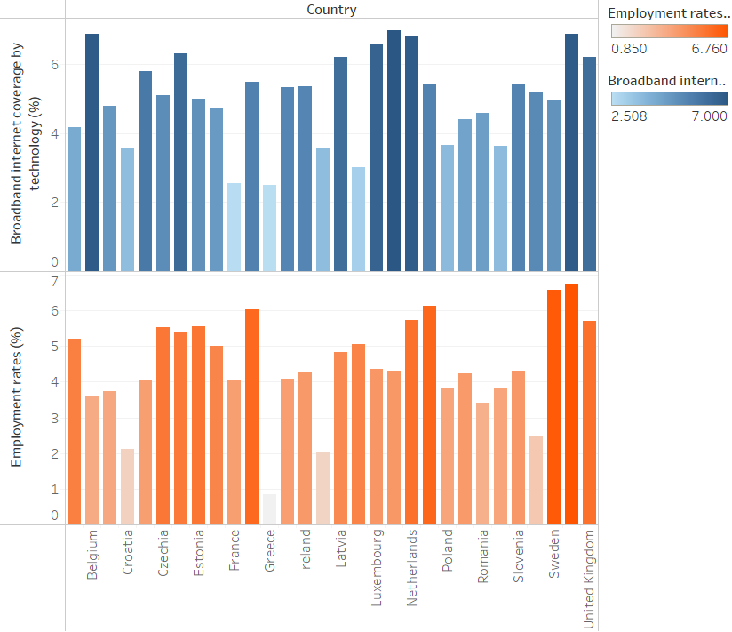
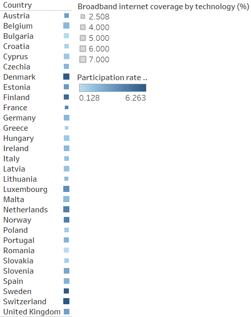
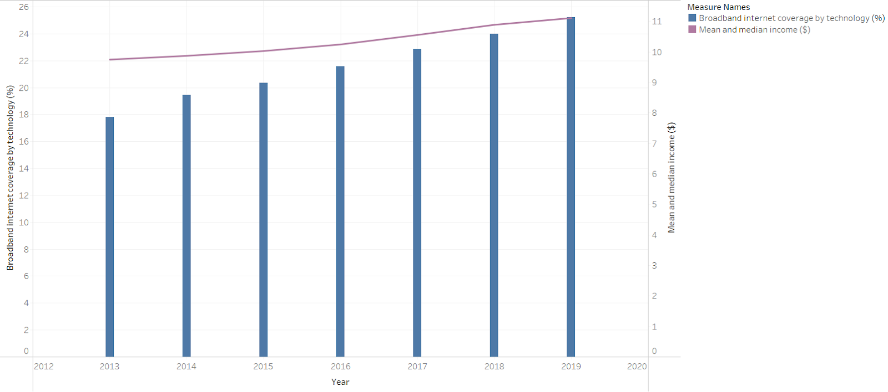

# ICT and Quality of Life in Europe

An academic group study exploring associations between information and communication technology (ICT), socioeconomic conditions, and environmental indicators across European countries. This summary is based on the Team Birst Business Analytics for Managers report dated May 1, 2023.

[Portfolio project](https://shetty21.github.io/#/projects/ict-quality-of-life)

## Research questions

The report organizes 22 questions around ICT adoption and outcomes such as employment, income, education, life expectancy, and environmental conditions. Several analyses cover **2013-2019**.

The questions include whether broadband availability relates to employment and training participation, how digital adoption varies by country, and whether ICT indicators show consistent relationships with environmental measures.

## Analysis approach

The report uses country and regional comparisons, charts, maps, trend views, and model-output summaries. The selected figures retain the original report's labels and aggregation. The underlying data and workbook were not supplied, so no additional statistics are estimated here.

The hypothesis table contains expected conclusions. The findings below refer to the report's subsequent observations rather than treating those expectations as results.

## Abhidith Shetty's documented contribution

The report explicitly credits Abhidith Shetty with **Figures 6-10**, covering:

- Broadband coverage and employment by country.
- Broadband coverage and participation in education and training.
- ICT workforce, employment, and e-banking/e-commerce trends.
- Broadband coverage and greenhouse-gas emissions over time.
- Broadband coverage and income trends.

These are contributions to a group study, not a claim of sole authorship of the report or its other analyses.

## Reported findings

1. The broadband and employment comparison describes a general positive association across the countries examined.
2. The broadband and training-participation analysis reports substantial country variation and no consistent relationship across all countries.
3. The income comparison describes higher broadband coverage alongside higher income, motivating further investigation of the digital divide.
4. Environmental relationships are mixed across the report's charts, so a single conclusion about ICT causing or reducing environmental harm is not supported.

### Broadband coverage and employment

### Broadband coverage and training participation

### Broadband coverage and income

## Interpretation and limitations

The analyses identify questions for digital-infrastructure and education policy. They do not establish that increased broadband or ICT employment causes changes in income, employment, or life expectancy.

Country comparisons may reflect differences in economic development, population, policy, and aggregation. The published figures preserve the source's units and scales; they should not be interpreted as independently verified national percentage estimates. Country-level associations also do not establish individual outcomes.

The report contains inconsistent outcome descriptions around its final modelling section, so those model metrics are not promoted as validated findings here.

## Materials and attribution

This was a Team Birst group project including Abhidith Shetty. Only contributions explicitly credited in the report are attributed individually above.

This repository contains the summary and selected original figures. The full Word report remains private. The [portfolio cover](assets/portfolio-cover.png) is a website illustration. Raw data, analysis scripts, and an interactive dashboard workbook are not included, and the study has not been independently reproduced here.
